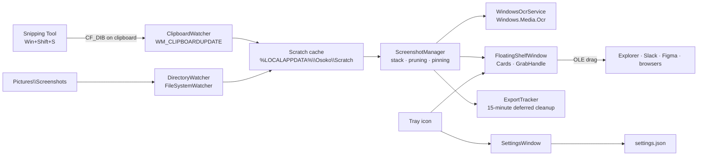

# Osoko for Windows

**A floating shelf for screenshots.** Capture with Snipping Tool, and the shot appears on a
translucent shelf in the corner of your screen — ready to copy, OCR, pin, save, or drag
straight into any app. Nothing is docked, nothing lands in your taskbar, and the shelf never
shows up in the screenshots it holds.

This repository is the native **Windows 10/11** port of Osoko for macOS: same philosophy,
rebuilt in **C# 13 / .NET 9 / WPF** with Win32 interop instead of AppKit.

```text
   ┌──────────────────────────────┐
   │  ▣  Osoko              🗑  ⚙ │
   ├──────────────────────────────┤
   │  ┌────────────────────────┐  │
   │  │                        │  │
   │  │      screenshot        │  │╭──╮
   │  │                        │  ││ ‹│
   │  └────────────────────────┘  ││ ▤│
   │  14:32 · Snipping Tool       ││ 3│
   │                              │╰──╯
   │  ┌────────────────────────┐  │
   │  │      screenshot        │  │
   │  └────────────────────────┘  │
   └──────────────────────────────┘
```

---

## Features

| | |
| :--- | :--- |
| **Zero-friction capture** | Intercepts `Win+Shift+S` / Print Screen output through the clipboard (`WM_CLIPBOARDUPDATE`) and watches `Pictures\Screenshots` — no need to change how you screenshot. |
| **Ghost shelf** | Borderless, always-on-top, `WS_EX_NOACTIVATE` + `WS_EX_TOOLWINDOW`: never steals focus, never appears in Alt+Tab or on the taskbar, and `WDA_EXCLUDEFROMCAPTURE` keeps it out of screenshots and screen recordings. |
| **Auto-collapse** | Slides off the right edge after 10 s of inactivity (3–60 s, configurable) leaving a slim grab handle that shows the number of parked captures. Hover the handle or touch the screen edge to peek it back in. |
| **Modular action slots** | Customize four icon slots per card (two top-right, two bottom-right) and configure single-click and double-click card gestures. |
| **1x downscaled copy** | Halves capture dimensions with high-quality WIC filtering so HiDPI screenshots don't blow out chat widths in Slack, Teams, or GitHub. |
| **Smart QR & barcode detection** | Background detection using `ZXing.Net`. Detected codes display an interactive pill badge (`QR: domain.com`) with one-click URL launch or clipboard copy. |
| **Privacy Shield** | Local on-device auto-redaction. Uses native Windows OCR word bounding boxes and regex to detect and black out API keys, tokens, emails, and credentials with solid rounded bars. |
| **Hover shortcuts** | Instant single-key actions (`1`, `2`/`C`, `T`, `R`, `L`, `P`, `S`, `Space`, `Delete`) when hovering any card without needing to click first. |
| **Offline OCR** | Windows' built-in `Windows.Media.Ocr` engine — ~100 ms, no cloud, no extra download. One click copies the recognised text; the result is cached per capture. |
| **Drag anywhere** | Native OLE drag & drop with four formats at once: `CF_HDROP` (Explorer, Slack/Figma desktop), `CF_DIB` + `CF_BITMAP` (legacy Win32 apps) and PNG (web Slack, Discord, browser uploaders). |
| **Smart stack** | Newest first, capped at 5 by default (1–15). Older captures are pruned automatically; pinned captures are never pruned. |
| **Fluent UI** | Rounded translucent cards, hover toolbars, a segmented settings surface, Mica/rounded-corner DWM integration on Windows 11, and a dark tray menu. |
| **Tidy by default** | Intercepted files are moved into Osoko's scratch cache so `Pictures\Screenshots` stays clean. Files handed to other apps are retained for 15 minutes and then deleted. |
| **Lightweight** | One self-contained `Osoko.exe` (~single file), no installer prerequisites, no background service, no telemetry. |

---

## Requirements

- **Windows 10 version 2004 (build 19041) or newer**, or **Windows 11** (x64).
- A Windows OCR language pack matching at least one display language (installed by default on
  virtually every desktop; `en-US` is used as a fallback).
- For **building**: [.NET 9 SDK](https://dotnet.microsoft.com/download/dotnet/9.0) and, for the
  installer, [Inno Setup 6](https://jrsoftware.org/isinfo.php).
- No administrator rights: Osoko installs per-user and only writes inside your profile.

## Install

1. Download `OsokoSetup-<version>-x64.exe` from the [Releases](../../releases) page and run it.
2. Or grab the portable `Osoko.exe` — it is self-contained and can run from anywhere.
3. Osoko starts in the notification area. Press `Win + Shift + S`, snip something, and the
   capture lands on the shelf in the bottom-right corner.

The installer creates a Start Menu entry, an optional desktop shortcut and a standard
uninstaller (Apps & Features). An optional task registers Osoko to start with Windows; you can
change that later in **Settings → General → Launch at Windows startup**.

---

## Using Osoko

### Capture

| Action | How |
| :--- | :--- |
| Snip a region | `Win + Shift + S` (Windows Snipping Tool) |
| Snip via Osoko | `Alt + Shift + S` — optional hotkey, enabled in Settings → Interception & Storage |
| Full screen | `Print Screen` (if Snipping Tool is configured to copy to clipboard) |
| Save to `Pictures\Screenshots` | Detected by the folder watcher and pulled onto the shelf |
| Any image on the clipboard | Optional: Settings → Interception & Storage → “Also capture images copied from any app” |

### Card actions

Hover a card to reveal its toolbar and badges:

| Control | Result |
| :--- | :--- |
| **Top-Right Slots** | Configurable quick actions (default: **Save to Location** and **Pin**). |
| **Bottom-Right Slots** | Configurable quick actions (default: **Copy 1x Downscaled** and **Share**). |
| **QR Badge** | Pill badge showing detected barcode / domain; click to open or copy URL. |
| ✕ **Close** | Dismisses and deletes the capture from the shelf and the scratch cache. |
| **Left Click** | Triggers configured primary action (default: **Copy 2x Original**). |
| **Double Click** | Triggers configured double click action (default: **Open in Preview**). |
| **Right Click** | Full context menu with 1x/2x copy, OCR, redaction, QR link, save as, share, pin, open, and settings. |
| **Drag the card** | Drops a file + bitmap + PNG into any application. With “Consume after drag & drop” enabled the card leaves the shelf and its file is cleaned up 15 minutes later. |

### Hover shortcuts

Hover your cursor over any card in the shelf to trigger instant single-key actions:

| Key | Action |
| :---: | :--- |
| **`1`** | Copy 1x downscaled (halves HiDPI dimensions for Slack and GitHub) |
| **`2`** or **`C`** | Copy original resolution (full bitmap) |
| **`T`** | Copy recognized text (OCR) |
| **`R`** | Redact sensitive data (API keys, tokens, emails, cards) |
| **`L`** | Open or copy detected QR code link |
| **`P`** | Toggle pin (keeps the card on shelf) |
| **`S`** | Save to default location (`Shift+S` for Save As) |
| **`Space`** | Open in default image viewer |
| **`Delete`** or **`Backspace`** | Remove card from shelf |

### Settings

| Section | Options |
| :--- | :--- |
| **General** | Launch at Windows startup · show tray icon · play sound effects · copy new captures to the clipboard |
| **Shelf & Stack** | Max captures on the shelf (1–15) · auto-collapse toggle · idle delay (3–60 s) · consume after drag & drop |
| **Actions & Toolbar** | Configure Top-Right Slots 1 & 2 · Bottom-Right Slots 1 & 2 · Single-click gesture · Double-click gesture · Hover shortcuts toggle |
| **Interception & Storage** | Watch clipboard · capture from any app · watch `Pictures\Screenshots` · keep Pictures clean · default save folder · ask for a file name · `Alt+Shift+S` hotkey |

Settings are saved to `%LOCALAPPDATA%\Osoko\settings.json` on **Save**. Cancel discards every
change because the dialog edits a clone. **Restore defaults** resets all values.

---

## How it works



- **Capture detection** — a message-only `HwndSource` registers
  `AddClipboardFormatListener`. Updates are debounced (180 ms), the clipboard owner is resolved
  through `GetClipboardOwner` / `GetForegroundWindow` + `GetThreadProcessId`, and only
  Snipping Tool (`ScreenClippingHost.exe`), shell processes or unknown owners are ingested unless
  “any app” is enabled. Duplicate images (same SHA-256 as the last capture within 3 s, or any
  capture in the last 20 s) are discarded.
- **Files** — every accepted capture becomes a PNG named `Osoko_yyyyMMdd_HHmmss_fff.png` in the
  scratch cache. The folder watcher moves files out of `Pictures\Screenshots` (configurable),
  waits until the file is readable, and hands it to the same manager.
- **Stack** — `ScreenshotManager` keeps an `ObservableCollection` (newest first), decodes a
  560 px frozen thumbnail plus the true pixel size, enforces the configured limit and raises
  events the shelf listens to. All deletions are restricted to the scratch folder.
- **OCR** — `WindowsOcrService` creates the engine once on a background thread (prewarmed at
  startup), downscales images larger than `OcrEngine.MaxImageDimension`, normalises line
  endings and caches the result on the item.
- **Ghost window** — `DwmHelper.MakeGhostWindow` applies `WS_EX_NOACTIVATE` and
  `WS_EX_TOOLWINDOW`, then `SetWindowDisplayAffinity(WDA_EXCLUDEFROMCAPTURE)`; if that fails on
  older builds it falls back to `WDA_MONITOR`. The window is positioned inside the *active*
  monitor's work area (`MonitorFromPoint` + `GetMonitorInfo`), so it sits above the taskbar on
  multi-monitor and mixed-DPI setups.
- **Export protection** — `ExportTracker` remembers saved/dropped paths so watchers ignore
  Osoko's own output, and keeps dropped files for 15 minutes (`ScheduleDeferredCleanup`) before
  deleting them.

### Project layout

```text
osoko-win/
├── Osoko.sln
├── Directory.Build.props              # shared language level & build settings
├── src/Osoko/
│   ├── Osoko.csproj                  # net9.0-windows10.0.19041.0 · WPF · single-file publish
│   ├── app.manifest                   # PerMonitorV2 DPI, asInvoker, long paths
│   ├── GlobalUsings.cs
│   ├── Assets/                        # osoko.ico (multi-resolution) + 256 px preview
│   ├── Core/
│   │   ├── AppPaths.cs                # %LOCALAPPDATA%\Osoko, Scratch, Pictures\Screenshots
│   │   ├── OsokoSettings.cs           # observable settings POCO with defaults
│   │   ├── SettingsManager.cs         # JSON persistence + HKCU Run key
│   │   ├── ScreenshotItem.cs          # stack item model
│   │   ├── StackCollapseState.cs      # Expanded / Collapsed / HoverPeek state machine
│   │   ├── Log.cs                     # rolling file log
│   │   └── Services/
│   │       ├── Abstractions.cs        # IImageLoader, IClipboardService, IFileDialogService, IScreenshotOcrService
│   │       ├── ScreenshotManager.cs   # stack, pruning, copy, OCR, save, consume
│   │       ├── ClipboardWatcher.cs    # message-only WM_CLIPBOARDUPDATE listener
│   │       ├── DirectoryWatcher.cs    # Pictures\Screenshots watcher
│   │       ├── WindowsOcrService.cs   # Windows.Media.Ocr integration
│   │       ├── ExportTracker.cs       # deferred 15-minute retention queue
│   │       ├── ScratchStore.cs        # scratch cache + SHA-256 fingerprints
│   │       ├── WpfImageLoader.cs      # frozen thumbnails + metadata
│   │       ├── ClipboardService.cs    # clipboard writes with OwnWriteStarted signal
│   │       ├── FileDialogService.cs   # Save / folder pickers
│   │       ├── AudioService.cs        # generated WAV cues (capture / copy / delete)
│   │       └── HotkeyService.cs       # Alt+Shift+S → ms-screenclip:
│   ├── Interop/
│   │   ├── NativeMethods.cs           # user32 / dwmapi / shell32 / shcore P/Invokes
│   │   ├── WindowStyles.cs            # WS_EX_*, WDA_*, DWMWA_*, hotkey modifiers
│   │   ├── DwmHelper.cs               # ghost window, capture exclusion, Mica, corners
│   │   └── ScreenHelper.cs            # work areas & DPI-aware coordinates
│   └── UI/
│       ├── App.xaml(.cs)              # single instance, tray, service wiring, lifecycle
│       ├── FloatingShelfWindow.xaml(.cs)
│       ├── SettingsWindow.xaml(.cs)
│       ├── TrayIconManager.cs         # NotifyIcon + dark context menu + icon loader
│       ├── ToastService.cs            # process-wide toast channel
│       ├── Controls/ScreenshotCard.xaml(.cs)
│       ├── Controls/GrabHandle.xaml(.cs)
│       ├── Converters/CommonConverters.cs
│       └── Styles/FluentColors.xaml · ControlStyles.xaml
├── tests/Osoko.Tests/                 # xUnit: settings, export tracker, stack manager
├── installer/OsokoSetup.iss           # Inno Setup 6 script
└── .github/workflows/build-release.yml
```

---

## Build & test

```powershell
# Restore & build
dotnet restore Osoko.sln
dotnet build Osoko.sln -c Release

# Unit tests (Windows; the projects target net9.0-windows10.0.19041.0)
dotnet test tests\Osoko.Tests\Osoko.Tests.csproj -c Release

# Self-contained single-file executable
dotnet publish src\Osoko\Osoko.csproj -c Release -r win-x64 --self-contained true `
  -p:PublishSingleFile=true `
  -p:IncludeNativeLibrariesForSelfExtract=true `
  -p:EnableCompressionInSingleFile=true `
  -o publish\win-x64
```

The publish profile `src/Osoko/Properties/PublishProfiles/win-x64.pubxml` contains the same
settings, so `dotnet publish -p:PublishProfile=win-x64` works too.

### Installer

```powershell
choco install innosetup -y
& "${env:ProgramFiles(x86)}\Inno Setup 6\ISCC.exe" installer\OsokoSetup.iss /DMyAppVersion=1.0.0
# → installer\Output\OsokoSetup-1.0.0-x64.exe
```

### CI/CD

`.github/workflows/build-release.yml` runs on `windows-latest` for every push/PR to `main`
and for `v*` tags:

1. `dotnet restore`, `dotnet build -warnaserror`, `dotnet test` (with coverage collection).
2. Self-contained, single-file `dotnet publish` for `win-x64`.
3. Inno Setup compilation with the tag (or `1.0.<run>`) as the installer version.
4. Artifacts: portable `Osoko.exe`, installer and TRX/coverage results.
5. Tagged builds publish a GitHub Release with both binaries and generated release notes.

---

## Data & privacy

Everything stays on your machine.

| Path | Purpose |
| :--- | :--- |
| `%LOCALAPPDATA%\Osoko\settings.json` | Preferences (human-readable JSON). |
| `%LOCALAPPDATA%\Osoko\Scratch\` | Cached PNGs shown on the shelf. |
| `%LOCALAPPDATA%\Osoko\logs\osoko.log` | Rolling diagnostic log (≤ 1 MiB). |
| `%USERPROFILE%\Pictures\Screenshots\` | Watched; files are moved into Scratch when “Keep the Pictures folder clean” is on. |

- No network calls, no analytics, no accounts. OCR runs in-process through Windows.
- Osoko only deletes files inside its own scratch folder and files it has registered as
  deferred exports.
- The shelf is excluded from screen capture (`WDA_EXCLUDEFROMCAPTURE`), so it cannot photograph
  itself or leak into streams.

## Troubleshooting

| Symptom | Fix |
| :--- | :--- |
| Nothing appears after `Win+Shift+S` | Check that Snipping Tool copies to the clipboard (Snipping Tool → Settings). Ensure **Watch the clipboard** is enabled. If another clipboard manager owns the clipboard, Osoko may never see the image — enable “Also capture images copied from any app”. |
| “Copy text” says *No text found* | The capture has no recognisable text, or no OCR language pack is installed (Settings → Time & language → Language → Add a language with “Optical character recognition”). |
| The shelf never collapses | Auto-collapse may be disabled, or the pointer is moving inside the shelf (movement re-arms the timer). |
| `Alt+Shift+S` does nothing | Another app owns the combination. Disable the hotkey in Settings and use `Win+Shift+S` directly. |
| The shelf is missing after a restart | Osoko starts minimized to the tray. Double-click the tray icon or launch Osoko again (the second launch reveals the running instance). |
| Drag & drop does nothing in an app | Some apps only accept files. Try dropping onto Explorer first, or paste (`Ctrl+V`) after using **Copy image**. |

Logs: `%LOCALAPPDATA%\Osoko\logs\osoko.log`.

---

## Credits

Osoko for macOS inspired the interaction model — a temporary, non-activating shelf instead of a
growing folder of screenshots. This port keeps the same idea and implements it with WPF, Win32
interop and the Windows OCR engine.

## License

[MIT](LICENSE) © Osoko
